# 平方影视二十种主题方案与布局优化

建议先选择 01 静幕影院作为默认首页方向；如果用户以搜索找片为主，优先选择 02 白昼片库；希望建立编辑内容特色时，再选择 03 编辑放映室。三者分别解决均衡浏览、检索效率和内容发现。

本文件提供 20 套有不同内容组织方式的设计方案，每套包含桌面与手机结构图、配色、排版、详情与播放页方向、数据依赖和验收条件。结构图用于比较布局，不代表已实现页面或真实影片数据。

### 本次交付与判断依据

基于 2026 年 10 月 22 日当前工作区源码审阅，基线提交为 4a07edc，包含工作区已有未提交改动。当前是同一套 pingfangvideo 模板支持 7 套可切换外观。已有的继续观看、筛选和线路选择应优先复用。

本次新增方案文档和示意图；网站布局优化是后续实施建议。没有修改生产模板、发布主题或调整数据库，也未进行线上用户行为测量。

### 先做的布局优化

**回访路径** 有历史时前移继续观看；无历史时直接露出可浏览影片。

**内容分工** 让主推、热度、最新内容承担不同任务，先核对数据再做跨区去重。

**跨页一致** 列表、详情与播放共用清楚的片名、状态、线路和选集规则。

### 阅读方式

第 2 页比较全部方案；第 3 至 4 页说明现状与通用布局规则；第 5 至 24 页为每套方案；第 25 至 27 页给出推荐顺序、实施验收和出处。

成本是设计估计：低表示主要调整样式或模块顺序；中表示涉及模板、交互或原生模块补齐；高表示需要数据治理、新交互链路或设备验收。不是工时报价。

## 二十种方案总览

编号便于讨论与选型，不表示优劣排名。建议优先比较前三套；18 清晰大字的规则可作为所有方向的共同基础。

| 编号 | 方案 | 主要布局差异 | 成本 | 页 |
| --- | --- | --- | --- | --- |
| 01 | 静幕影院 | 一部主推加一条回访路径 | 中 | 5 |
| 02 | 白昼片库 | 搜索与筛选成为首页主角 | 中 | 6 |
| 03 | 编辑放映室 | 一篇策展导语串起一组影片 | 中 | 7 |
| 04 | 今日追剧 | 按更新安排与观看状态找剧 | 高 | 8 |
| 05 | 我的片架 | 打开就接着上次看 | 中 | 9 |
| 06 | 海报长廊 | 让海报本身组织首页 | 低 | 10 |
| 07 | 排行观测站 | 排名与依据放在同一屏 | 中 | 11 |
| 08 | 专题群岛 | 先选一个主题再选影片 | 中 | 12 |
| 09 | 年代档案馆 | 沿年代纵向浏览电影 | 中 | 13 |
| 10 | 世界银幕 | 用地区分区替代传统大轮播 | 中 | 14 |
| 11 | 今晚看什么 | 用少量场景选项减少犹豫 | 中 | 15 |
| 12 | 短时光影 | 按可用时长选片 | 高 | 16 |
| 13 | 系列宇宙 | 把系列观看顺序摆清楚 | 高 | 17 |
| 14 | 导演手记 | 按创作者组织作品与短文 | 高 | 18 |
| 15 | 国风章回 | 用章节编排替代满屏纹样 | 中 | 19 |
| 16 | 胶片票根 | 以放映节目单呈现精选内容 | 中 | 20 |
| 17 | 霓虹放映厅 | 聚焦一张高对比主推海报 | 中 | 21 |
| 18 | 清晰大字 | 更大的文字与更少的入口 | 中 | 22 |
| 19 | 口袋速览 | 首屏直接给搜索与内容 | 中 | 23 |
| 20 | 客厅银幕 | 用方向键完成选片与选集 | 高 | 24 |

20 套方向不必同时进入主题菜单。先完成一个主布局，再根据真实反馈决定第二套；需要更多外观时共用卡片、筛选、线路和历史逻辑。

## 当前布局与优化机会

以下事实来自本地源码，未代替浏览器或生产验收。默认桌面首页已经采用主视觉加右侧榜单；继续观看也已实现，不应作为从零新增的能力描述。[S1–S4]

| 当前事实 | 布局建议 |
| --- | --- |
| 轮播与年度榜单均基于站内 hits 排序。 | 主推、热度和最新区分工；先检查重复率，再决定去重方式。 |
| 继续观看位于频道入口之后，有历史才显示。 | 回访型方案将其前移；空历史不留空白区域。 |
| 最新区只取当年影片，每组 6 项。 | 为往年佳作留入口；明确最近更新与新片上映的差别。 |
| 桌面默认主视觉旁已有 292px 榜单。 | 以现有双栏为起点调整主次，不把全站都认定为大轮播。 |
| 详情展开所有线路及剧集，手机播放页已有选集抽屉。 | 桌面尝试右侧选集；长剧按区间分组并保留手动换线。 |
| 专题首页和详情当前为兜底页面。 | 策展类方案需要补模板与数据，不能只交付视觉样式。 |

### 数据与能力边界

现有主题选择保存在本浏览器；收藏不等于可命名、排序、共享的自建片单。首页历史不能证明账号已支持跨设备秒级续播。同类随机推荐也不能称为个性化推荐。[S2–S5]

线路健康检测已有实现，但它反映服务端到播放源的检测，不能作为用户本地播放体验保证。方案中的播放布局优化仍需保留原生播放器链路。[S5]

## 所有方案共用的布局规则

以下数值是实施起点，需结合真实长片名、图片比例和设备测试调整。优先维持同一套信息顺序，再通过列数、区块宽度与模块显隐适配。

| 项目 | 建议规则 |
| --- | --- |
| 桌面与平板 | 主内容最大宽度约 1320px；大桌面 5–6 列海报，中等宽度 3–4 列。 |
| 手机 | 360–430px 以双列海报或单列信息卡为主，左右边距 16px；大字模式优先单列。 |
| 信息层级 | 片名常显且最多两行；年份和状态为次级信息，评分、线路与清晰度不得混淆。 |
| 图片 | 海报固定 2:3，横幅按素材选择；预留尺寸防跳动，缺图保持同一占位结构。 |
| 间距与触控 | 使用 8px 间距步进；普通主控件建议至少 44×44px，大字模式建议 48px 起。 |
| 动作与焦点 | 一块内容只有一个明显主动作；可见键盘焦点，减少动态效果设置可关闭非必要动效。 |

### 必须覆盖的状态

新访客、已有历史、未登录与已登录；空分类、无搜索结果、缺图、长片名；多线路、超长选集、网络失败。主内容按这些状态稳定排列，不能依赖固定样例数量。

### 主题切换与页面一致性

若实际扩展到多套方案，导航只保留一个外观入口，再用缩略图面板分组展示；当前主题与最近使用项清楚可见。颜色偏好与模块布局分别处理，避免每套方案复制全站逻辑。

列表保留筛选条件和分页；详情将播放与选集置前；桌面播放页可采用播放器加选集侧栏，手机复用现有抽屉。所有改动需核对三条渲染链。

## 01 静幕影院

**均衡首页  ·  成本中** 兼顾新访客与回访观众，适合作为默认首页。

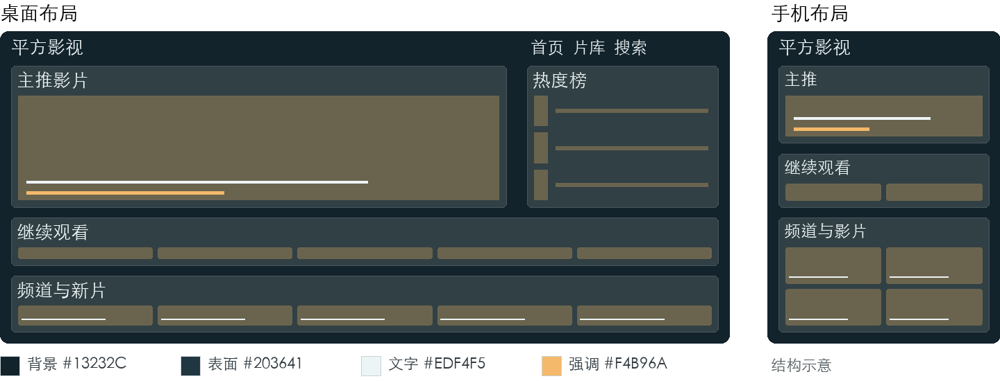

**视觉与字体** 标题用黑体中粗，正文用系统无衬线；片名比区块标题更醒目。

**桌面布局** 延续主视觉与右侧榜单双栏；主视觉只保留一部主推和一个主按钮。继续观看紧随其后，频道入口与最新内容合并成连续浏览区。

**手机布局** 主视觉控制在首屏约四成高度；有历史时先露出继续观看，无历史时直接接双列海报。榜单缩为三条摘要并提供查看全部。

**详情与播放** 详情页先给片名、更新状态与播放入口；播放页让选集靠近播放器，介绍与相关推荐后置。

**数据与实现** 复用现有轮播、榜单、历史、频道数据；主推优先使用维护过的推荐内容，无推荐时用明确标注的热播。

**取舍** 主推数量减少会降低首页同时曝光量；用后续内容区补足，不能用自动播放视频填充空间。

**验收重点** 390px 宽下主按钮与轮播控件互不覆盖；有无历史两种首屏都能看到可点的影片入口。

## 02 白昼片库

**高效检索  ·  成本中** 有明确片名、类型或年份目标的用户。

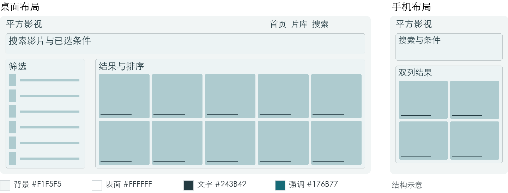

**视觉与字体** 黑体标题与正文，年份和集数使用等宽数字；避免细灰字。

**桌面布局** 去掉首页大轮播，以宽搜索框开场；左侧固定宽度筛选，右侧用整齐海报网格。已选条件独立成行，排序和结果数量同处一条工具栏。

**手机布局** 搜索框置顶；筛选从底部面板展开，已选条件常显并可单独移除。影片默认双列，返回列表恢复条件和滚动位置。

**详情与播放** 详情页保留返回结果入口；播放页显示当前片名和集数，下一集按钮位置固定。

**数据与实现** 复用搜索、分类、筛选和分页能力；筛选值以实际目录为准，空值不生成无效选项。

**取舍** 筛选过多会增加决策成本；首屏只放类型、年份、地区，其他条件按需展开。

**验收重点** 筛选后刷新或返回仍能还原 URL 条件；无结果时能一键清除条件，分页保留筛选。

## 03 编辑放映室

**品牌内容  ·  成本中** 愿意发现冷门佳作、阅读选片理由的观众。

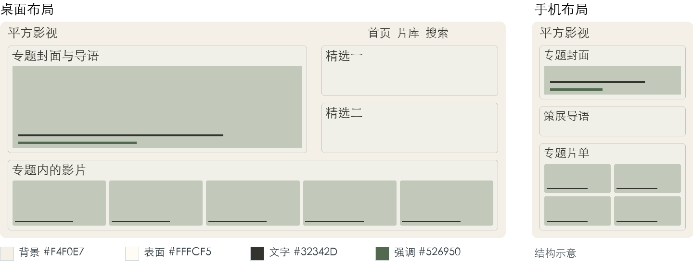

**视觉与字体** 宋体仅用于策展标题，片名和正文用黑体；长文保持短行。

**桌面布局** 左侧大专题封面配短导语，右侧两张精选卡形成不对称布局；下方按专题组织横向影片组，穿插一段编辑推荐理由。

**手机布局** 封面、导语、影片顺序单列展开；理由控制为两行摘要，用户可展开阅读。常规影片仍用双列网格。

**详情与播放** 专题页展示策展理由和片单；详情页给出返回专题入口，播放页保留轻量的同专题下一部。

**数据与实现** MacCMS 原生支持专题；当前专题页是兜底页，需要补齐列表、详情及关联影片渲染。导语和理由由运营维护，无文案时用普通列表。

**取舍** 持续需要内容编辑；缺少维护时不要显示空白栏目或伪造编辑背书。

**验收重点** 一个专题仅有 1 部影片或缺少封面时仍成立；移动端不把两栏强行压缩成小字。

## 04 今日追剧

**追更入口  ·  成本高** 连续追看剧集、动漫和综艺的回访用户。

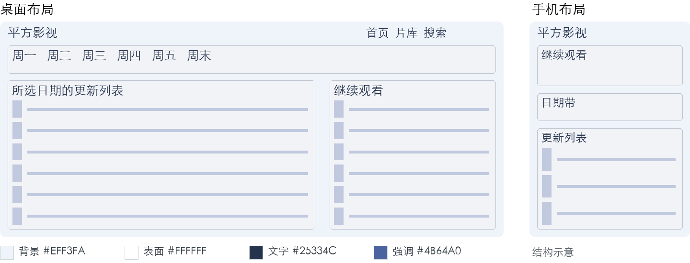

**视觉与字体** 黑体标题，日期和集数用等宽数字，更新状态用文字加图形。

**桌面布局** 顶部日期带切换周一至周日；左侧为所选日期的更新列表，右侧为继续观看。更新卡以片名、当前集数和来源时间为主要信息。

**手机布局** 日期带横向滚动，更新列表单列；继续观看置于日期带之前。没有可靠排期时默认展示最近更新。

**详情与播放** 详情页突出是否完结与当前集数；播放页选集按区间折叠，已选集明确标注。

**数据与实现** 节目周期可用官方 vod_weekday 字段，需核对数据完整度；vod_time 仅代表条目更新时间。精确播出时刻、订阅提醒需要额外数据或服务。

**取舍** 采集更新不等于新一集上线；不得由更新时间推断首播、已更新集数或承诺提醒。

**验收重点** 无排期、跨天、停更与完结都有明确状态；仅有条目更新时间时标题显示最近收录或更新。

## 05 我的片架

**个人回访  ·  成本中** 经常回访同一站点、以历史和收藏为起点的用户。

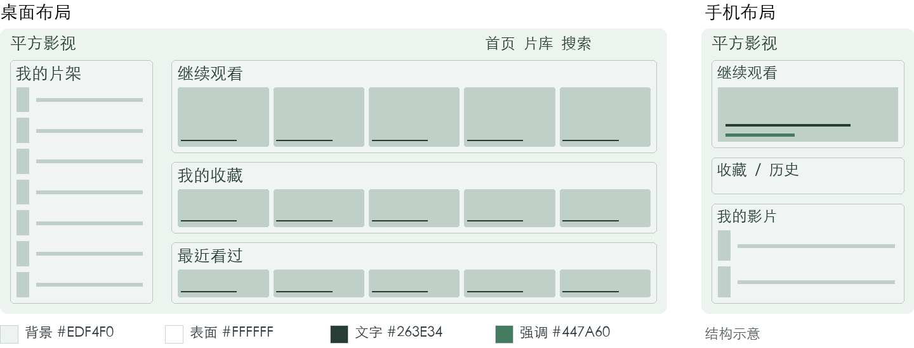

**视觉与字体** 亲和的黑体，内容分组用中号字；时间标签保持清楚。

**桌面布局** 左侧个人导航，主体先列继续观看，再列收藏与最近看过；访客首页仍有通用内容，不用登录墙挡住浏览。

**手机布局** 继续观看大卡居首；收藏与历史作为可切换标签，单列信息卡展示更长片名和最近集数。

**详情与播放** 详情页收藏动作与播放并列但层级较低；播放结束后提供返回片架入口。

**数据与实现** 复用现有本地历史及登录后的 MacCMS Ulog、收藏入口。跨设备进度同步和多个自建片单需另行核验或实现。

**取舍** 不要把访问过的集数当作精确播放进度；本地与账号数据的来源必须区分。

**验收重点** 未登录、已登录、空历史、历史失效链接都能继续发现内容；退出登录后不泄露账号收藏。

## 06 海报长廊

**视觉浏览  ·  成本低** 靠封面与题材直觉找片的用户，适合素材质量好的片库。

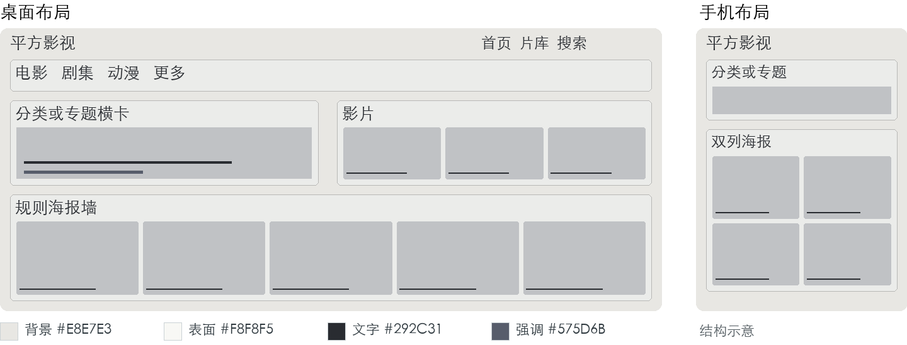

**视觉与字体** 海报下方统一黑体片名，减少标题字重和装饰。

**桌面布局** 以等高海报网格代替巨幅主视觉；首排设一张双倍宽的专题横卡，其余保持统一比例。顶部只保留导航、搜索和简短分类。

**手机布局** 双列海报优先，专题横卡跨两列；片名常显，不能依赖鼠标悬浮才出现。

**详情与播放** 详情页保留海报并把内容信息放到侧栏；播放页回归清晰的播放器与选集，不延续满屏装饰。

**数据与实现** 低成本按分类横卡首版估算；专题横卡需要补齐当前兜底专题页。沿用 vod_pic，竖图不强裁横幅，缺图保持占位。

**取舍** 高度依赖海报质量与图片体积；避免瀑布流导致排序难以理解和位置跳动。

**验收重点** 破图、超长片名和不同海报比例不改变卡片高度；键盘顺序与视觉顺序一致。

## 07 排行观测站

**热度决策  ·  成本中** 想快速了解站内热门内容的用户。

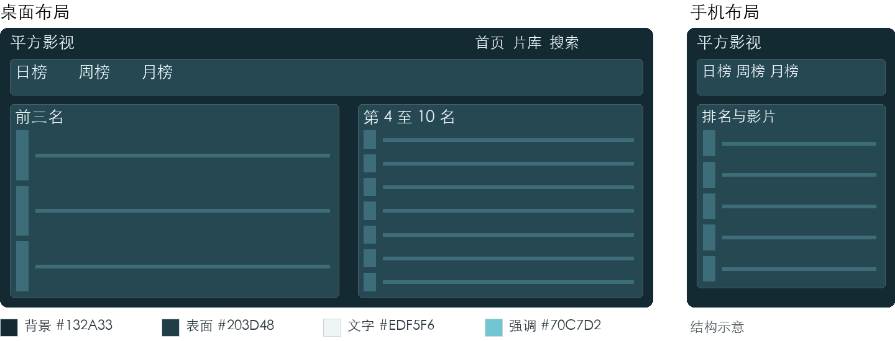

**视觉与字体** 榜单数字用等宽字体，片名用黑体；排名不压过片名。

**桌面布局** 日榜、周榜、月榜使用并列标签；左侧前三名横卡，右侧第 4 至 10 名紧凑列表。下方按频道分榜。

**手机布局** 顶部切换周期，单列排行；每项保留排名、封面、片名、更新状态，热度值作为次级信息。

**详情与播放** 详情页明确榜单周期与口径；播放页保留榜单返回入口，不在播放器边堆放多套榜单。

**数据与实现** 复用站内 hits_day、hits_week、hits_month 等字段；排名变化需要历史快照，当前方案不展示未经计算的上升箭头。

**取舍** 站内点击热度不等于全网热度或播放成功率；评分和热度不得混用。

**验收重点** 切换周期时标题和排序同步；相同数值使用稳定次序，零热度有合理空态。

## 08 专题群岛

**策展发现  ·  成本中** 不知道片名、愿意按题材或场景探索的观众。

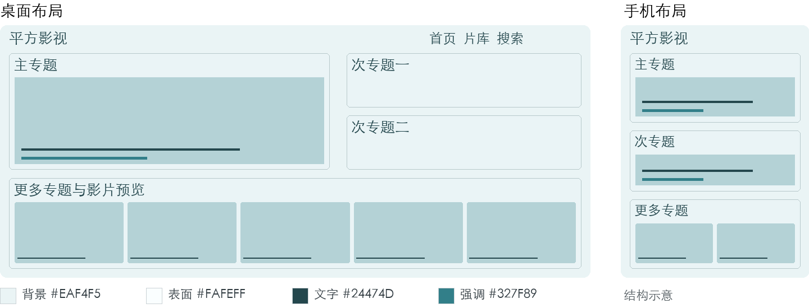

**视觉与字体** 专题标题用黑体中粗，卡片短说明采用正常字重。

**桌面布局** 首页为大小有序的专题分区：一个主专题、两个次专题、四个窄专题；每个专题附三张小海报预览，避免进入后才知内容。

**手机布局** 主专题在前，其余单列专题卡；每张最多显示三部预览，整个卡片跳到专题详情。

**详情与播放** 专题详情增加返回全部专题与关联主题；影片详情保留专题来源，播放页不重复加载整组专题。

**数据与实现** MacCMS 原生支持专题，但当前 topic/index 与 topic/detail 只有兜底内容，需要实现专题渲染并准备数据、排序与封面。空专题不进入首页。

**取舍** 专题标签相互重叠会增加迷路感；建立有限、清晰的专题名称。

**验收重点** 专题图片失败仍能读到标题与影片数量；从详情返回时保留专题列表位置。

## 09 年代档案馆

**资料浏览  ·  成本中** 按年代重温经典、整理观影计划的用户。

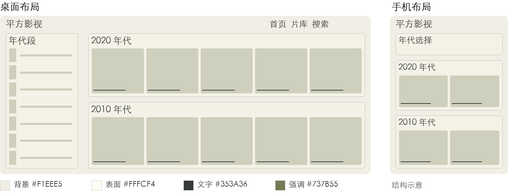

**视觉与字体** 年份采用等宽数字，章节标题宋体，卡片正文黑体。

**桌面布局** 顶部年代段导航，左侧是当前年份锚点，右侧按年份排列海报组。年份组开头显示数量，不用长篇历史文案撑版面。

**手机布局** 年代段变成单行选择器，当前年份常显；年份标题和对应影片纵向排列，分页限制一次加载量。

**详情与播放** 详情页突出年份、地区与导演，关联内容优先同年代；播放页仍使用常规选集布局。

**数据与实现** 基于实际 vod_year 聚合；缺少年份单列未标注，不能把更新时间当成出品年份。

**取舍** 旧片元数据不完整，过早强调精确年份可能误导；先清洗再扩展年份导航。

**验收重点** 空年份不留大片空洞；非数字年份和未标注项有稳定归属，筛选链接可直接分享。

## 10 世界银幕

**地区发现  ·  成本中** 按地区、语言或电影文化选片的用户。

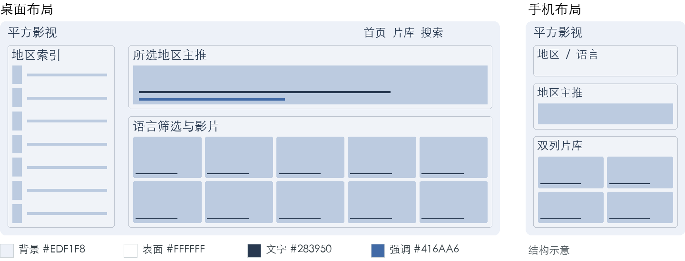

**视觉与字体** 地区标题黑体，外文别名作为次级文字，不用国旗替代名称。

**桌面布局** 左侧地区索引，右侧显示一个地区主推与对应影片网格；语言筛选独立放在结果工具栏，避免把语言与地区当成同一属性。

**手机布局** 地区选择压成短标签组，更多地区放入面板；内容区仍为双列海报，不使用交互地图占首屏。

**详情与播放** 详情页地区和语言分别标注；播放页字幕或音轨仅在真实播放器支持时提供控制。

**数据与实现** 复用地区、语言和分类字段，先统一异名；联合出品按既有数据模型呈现。

**取舍** 数据可能混用国家、地区及语言写法；不能由片名或海报自动猜测地区。

**验收重点** 地区与语言组合筛选结果正确；长地区名换行后按钮仍能点按。

## 11 今晚看什么

**场景选片  ·  成本中** 没有明确目标，希望快速得到一组选择的用户。

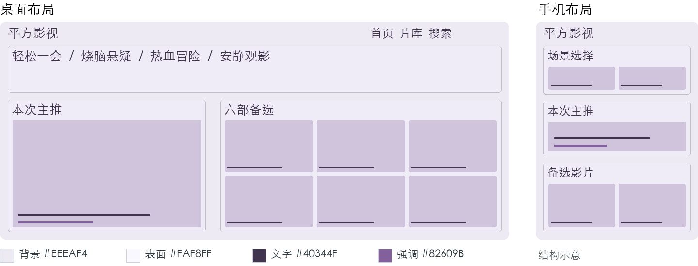

**视觉与字体** 场景词使用大号黑体；说明短而具体，避免人格测试式文案。

**桌面布局** 顶部四个场景入口，例如轻松一会、烧脑悬疑、热血冒险、安静观影；选中后显示一张主推与六部备选，保留直接浏览全部入口。

**手机布局** 场景按钮两列排列，结果以一张主推和双列备选展示；一次选择就能看到影片，不做长问卷。

**详情与播放** 详情页说明所属场景和编辑选片理由；播放页保留返回本次结果，避免自动连续播放不相关影片。

**数据与实现** 第一版用人工标签映射场景；若使用专题，需补齐当前兜底专题页。AI 识别、用户画像及个性化推荐均不属于现成能力。

**取舍** 情绪标签主观，不能把选择结果声称为了解用户；始终提供更换场景与全部片库。

**验收重点** 四个场景都能找到有效内容；映射为空时展示通用精选并明确说明。

## 12 短时光影

**时间预算  ·  成本高** 希望在午休或通勤等有限时间内看完内容的用户。

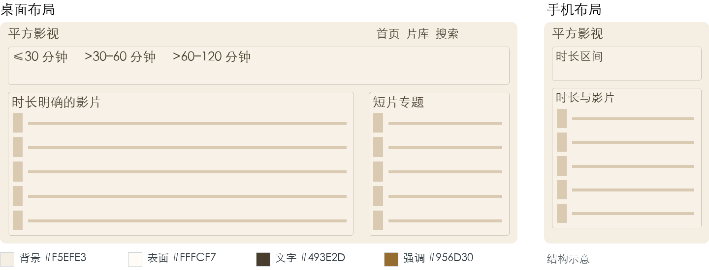

**视觉与字体** 时长数字放大，单位紧邻数字；正文用清晰黑体。

**桌面布局** 首页上方显示 不超过 30 分钟、超过 30 至 60 分钟、超过 60 至 120 分钟三个互斥区间；下方是时长明确的影片列表与适合一次看完的专题。

**手机布局** 时长作为分段选择器，结果使用小海报加两行信息的单列卡；不强制用户操作难点按的滑块。

**详情与播放** 详情页区分整部时长和单集时长；播放页只在可获取进度时显示可信的剩余时长。

**数据与实现** 官方提供 vod_duration，但内容格式和统计口径需清洗；区间过滤可能需要预计算或查询扩展，未知时长单列。

**取舍** 剧集总时长与单集时长混淆会破坏体验；不把备注中的数字直接当作分钟。

**验收重点** 30、60、120 分钟边界无遗漏；未知时长不会被自动归入短片，剧集口径有标注。

## 13 系列宇宙

**系列导航  ·  成本高** 需要了解续集、前传或系列关联的用户。

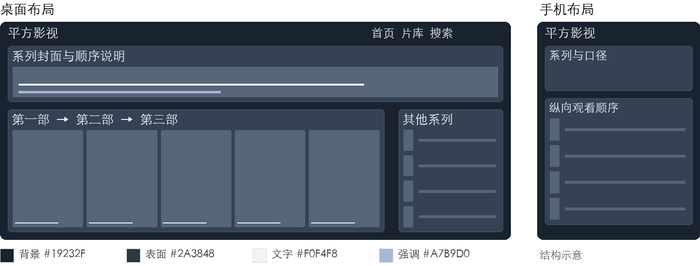

**视觉与字体** 序号用等宽字体，系列名黑体中粗；顺序说明保持紧凑。

**桌面布局** 一个系列封面配简介，下方采用按序连接的影片卡带；右侧列出顺序口径和其他系列，视觉上强调当前所在作品。

**手机布局** 影片顺序改为纵向步骤列表，一张卡只对应一部作品；播放入口与顺序说明分开。

**详情与播放** 详情页提供上一部和下一部；播放页结束后可打开下一部详情，避免跨作品自动开播。

**数据与实现** 可基于 MacCMS 专题新建系列页，当前专题模板需补齐；作品顺序和前传关系需人工维护，不能从片名数字推断完整系列。

**取舍** 上映顺序与故事时间顺序可能不同；第一版只维护一种口径并明确标注。

**验收重点** 系列有缺片时说明缺失而不是把顺序挤掉；单部作品和重复标题均可稳定定位。

## 14 导演手记

**作者发现  ·  成本高** 对导演、创作风格及作品关系感兴趣的用户。

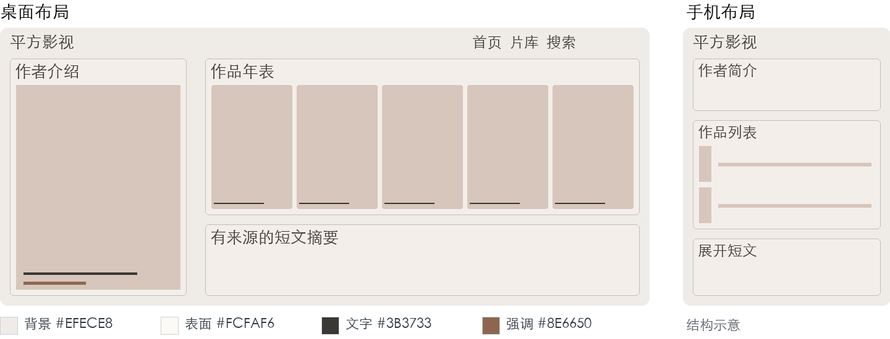

**视觉与字体** 宋体用于作者章节标题，片名和履历用黑体；留白服务阅读。

**桌面布局** 左侧作者介绍与作品筛选，右侧按时间排列精选作品；中间可穿插有来源的短文摘要，一页只强调一位创作者。

**手机布局** 作者信息折叠为简介，作品优先呈现；短文采用可展开摘要，避免占据整屏。

**详情与播放** 影片详情中导演名可进入作品集合；播放页结束后给出该作者的其他作品。

**数据与实现** vod_director 可作为检索起点；规范化作者身份、照片、履历和文章关联需要额外内容维护，不能默认 actor 模块就是导演库。

**取舍** 同名与多个导演容易错误归组；未经核验的生平、奖项和照片不应展示。

**验收重点** 多人联合执导、别名和缺失简介有明确处理；没有文章时仅保留作品列表。

## 15 国风章回

**文化视觉  ·  成本中** 偏好国产影视和克制东方视觉的观众。

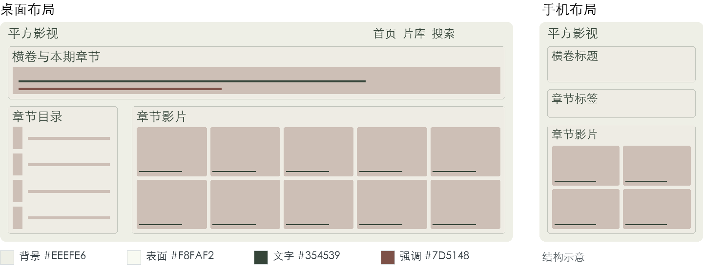

**视觉与字体** 宋体仅用于章节名，功能控件用黑体；横排保证检索效率。

**桌面布局** 借鉴现有水墨素材，以短幅横卷开场；内容按剧集、电影、纪实分章，章节目录位于左侧。每章仍使用规则海报网格。

**手机布局** 章目录变成顶部标签，横卷缩为标题背景；纸纹不覆盖文字，禁用横向滚卷式内容浏览。

**详情与播放** 详情页用章节分隔介绍与选集；播放页移除纹理背景，优先保证线路、集数与焦点清晰。

**数据与实现** 复用现有水墨主题资源与分类；章节内容来自可核验的分类映射，不直接写死频道 ID。

**取舍** 与现有水墨映画接近，价值应由章节导航体现；不要再新增一套只改颜色的皮肤。

**验收重点** 所有功能文字横排可读；开关纹理不改变排版，低对比纸色下按钮仍清楚。

## 16 胶片票根

**复古策展  ·  成本中** 喜欢老电影、复古文化与人工策展的用户。

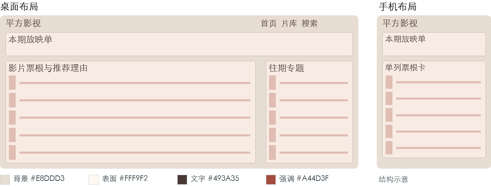

**视觉与字体** 标题宋体，场次序号与年份用等宽字，正文黑体。

**桌面布局** 上方为本期放映单，下面用横向票根卡排列影片：左侧小海报，中间片名与推荐理由，右侧进入详情。月度专题作为侧栏。

**手机布局** 票根转为单列信息卡，齿孔装饰只留边缘；每张卡至少有一行清晰片名。

**详情与播放** 详情页保留票根式元信息，播放页使用简洁中性色背景；装饰不侵占控制区域。

**数据与实现** 本期片单基于 MacCMS 专题与人工排序，需要补齐当前兜底专题页；期号由运营维护。不存在真实购票或直播排播能力。

**取舍** 票根容易让用户误认为可以买票或预约；按钮明确写查看影片或播放。

**验收重点** 不使用虚假倒计时和余票提示；长片名、缺海报时票根卡仍保持结构。

## 17 霓虹放映厅

**夜间风格  ·  成本中** 偏好夜间浏览、类型片和鲜明视觉风格的用户。

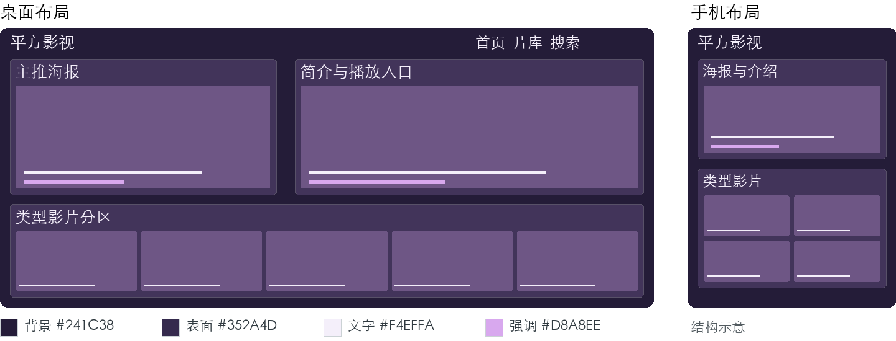

**视觉与字体** 粗黑体片名与常规正文；装饰字体不用于筛选和播放控件。

**桌面布局** 主推采用海报与简介并列的斜切视觉构图；下方分成科幻、悬疑、动作等稳定分区。发光仅用于当前焦点和选中状态。

**手机布局** 取消斜切重叠，海报与文字上下排列；所有信息常显，动效关闭后仍保持同一结构。

**详情与播放** 详情页可延续主色，播放器周边保持平静；选集状态使用实心与描边双重区分。

**数据与实现** 复用类型、推荐与海报；类型映射以当前分类和扩展分类为准。

**取舍** 持续粒子、模糊与自动动效会增加负担；第一版只用静态光晕，不承诺性能提升。

**验收重点** 减少动态效果设置生效；主图失败不导致按钮看不清，焦点不只依赖发光。

## 18 清晰大字

**易读操作  ·  成本中** 偏好大字、触控操作或需要更清楚界面的用户。

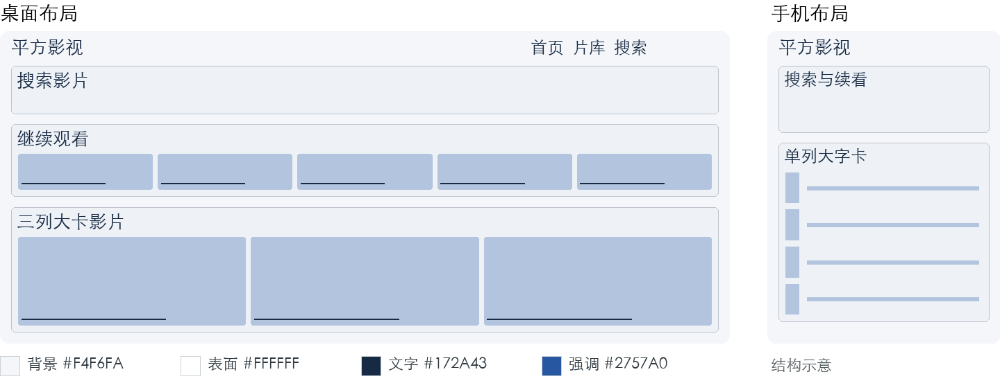

**视觉与字体** 正文建议 18px 起，标题 28px 起；使用系统黑体和清晰字重。

**桌面布局** 压缩导航项数量，搜索与继续观看放到最前；影片采用三列大卡，卡片内文字常显，常用操作配文字标签。

**手机布局** 单列横向信息卡，主要按钮建议至少 48px 高；筛选使用完整文字，不用仅图标的隐蔽入口。

**详情与播放** 详情页播放按钮显著、介绍可展开；播放页选集触控面积充足，明确提示当前线路和集数。

**数据与实现** 沿用现有数据；作为全站易读模式也可与其他布局组合，避免复制一套内容逻辑。

**取舍** 大字会减少同屏内容；必须在 200% 缩放下验证，不把少量检查称为完整无障碍认证。

**验收重点** 200% 缩放无文字截断或双向滚动；键盘焦点清楚，状态同时使用文字和视觉标记。

## 19 口袋速览

**移动效率  ·  成本中** 以手机浏览、希望少滚动快速找片的用户。

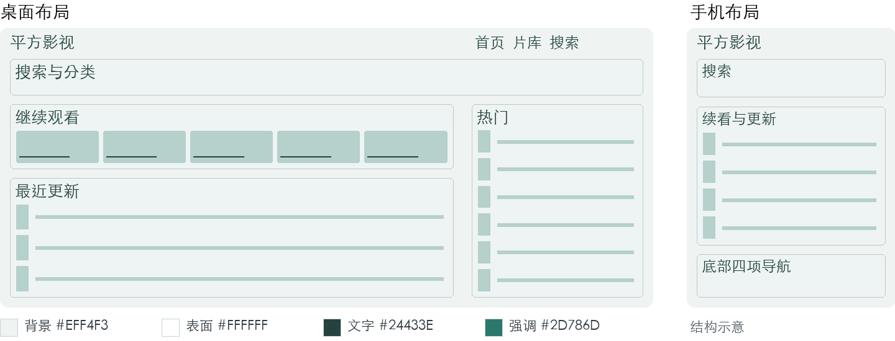

**视觉与字体** 系统黑体，片名与更新状态两级字号，避免细小胶囊标签。

**桌面布局** 桌面沿用紧凑列表，顶部搜索与分类合并为一条导航；主内容小海报配文本，侧栏仅保留一组热门。

**手机布局** 移除主视觉，把搜索、继续观看与最近更新连续排列；底部仅四个常用目的地，列表按页加载并保留返回位置。

**详情与播放** 详情页优先片名、播放与集数；播放页控制周边图片加载，收起长篇相关推荐。

**数据与实现** 复用现有搜索、历史与最近更新；节省流量需由图片尺寸、请求数量和真实网络测量证明。

**取舍** 紧凑不等于压缩触控区域；不能在没有对照实验时宣称节流比例或提速倍数。

**验收重点** 360px 下无横向溢出；固定底栏不遮挡最后一项，弱网和图片失败时仍可读可点。

## 20 客厅银幕

**大屏观看  ·  成本高** 连接电视的大屏浏览器和使用键盘或遥控器的用户。

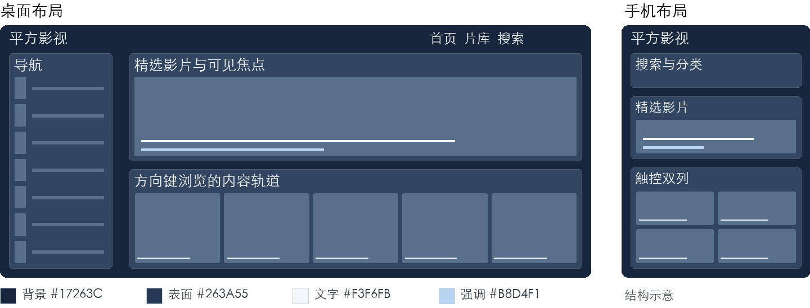

**视觉与字体** 远距大字，标题建议 36px 起，说明 22px 起；焦点边框比阴影更可靠。

**桌面布局** 左侧窄导航，右侧大幅精选与横向内容轨道；任一时刻只突出当前焦点。方向移动、返回和焦点恢复形成完整路径。

**手机布局** 使用同一内容分组但回到触控双列布局，不把大屏导航挤进手机；保留搜索和普通分页入口。

**详情与播放** 详情页播放按钮进入时即有可见焦点；播放页必须确认播放器能接收并释放键盘事件，返回后恢复原位置。

**数据与实现** 内容可复用；遥控器键值、浏览器兼容、焦点路由和播放器集成属于新增交互工程。

**取舍** 普通桌面网页成功不等于电视可用；自动播放策略和播放器控件需在目标设备实测。

**验收重点** 仅靠方向键、确认和返回能走完首页到播放再返回；不丢焦点、不困在播放器内。

## 推荐方向与实施顺序

在没有线上行为数据证明某一使用场景占主导前，优先实施 01 静幕影院。它能沿用当前首页双栏、历史和频道能力，同时调整首屏主次，新增数据依赖较少。

| 方向 | 选择它的条件 | 先做的内容 |
| --- | --- | --- |
| 01 静幕影院 | 默认首页需要兼顾新访客与回访。 | 精简主推；前移继续观看；优化手机榜单密度。 |
| 02 白昼片库 | 找片主要依靠搜索与筛选。 | 突出搜索；常显已选条件；恢复返回位置。 |
| 03 编辑放映室 | 有持续维护专题与文案的能力。 | 先补专题列表和详情，再做封面与片单混排。 |

### 建议采用的组合

默认首页选择 01，片库页面采用 02 的筛选与网格，专题频道采用 03 的策展结构。三者可以在同一主题中形成不同页面职责，比同时维护三套完整站点更简单。

18 清晰大字中的触控、焦点与可读性规则作为共同质量要求；19 口袋速览可作为手机布局参考。只有出现明确的大屏使用需求，再投资 20 的遥控器与播放器联动。

### 按需求选择的备选

追剧回访优先比较 04 与 05；内容素材成熟时考虑 06 与 08；片库元数据质量较好时考虑 09、10、12、13、14。15、16、17 适合视觉识别或运营活动，但仍要保持搜索和播放路径清楚。

### 如何判断优化是否有效

用同一组影片和同一设备比较旧版与候选版，观察找到指定影片、恢复上次观看、切换线路和定位某一集的任务完成情况。先记录基线，再讨论点击率、首播耗时或流量变化；本文件不承诺提升百分比。

## 实施与验收计划

| 步骤 | 交付内容 | 验证方式 |
| --- | --- | --- |
| 一 选定方向 | 确定主布局、手机顺序和必须的数据。 | 用真实长片名、空内容与多线路样例走读。 |
| 二 完成原型 | 做首页、列表、详情、播放四页，先选 1 套。 | 桌面 1440px、平板 768px、手机 360px 与 390px 检查。 |
| 三 接入模板 | 复用公共卡片与 MacCMS 路由，补必要模块。 | 对照官方标签，检查真实数据与分页、登录状态。 |
| 四 执行回归 | 覆盖键盘、触控、减少动效、空态与失败态。 | 运行仓库必需检查，并分别验证三条渲染链。 |
| 五 小范围发布 | 保留旧主题包和配置，准备回滚路径。 | 在目标环境确认真实播放、历史、收藏和线路切换。 |

### 改动落点

首页对应 html/index/index.html；公共头部、卡片与筛选位于 html/public；详情与播放位于 html/vod；专题对应 html/topic。按现有 data-theme 作用域组织样式，公共交互继续使用共享逻辑。[S1–S6]

部署资源继续使用 MacCMS 路径与 URL 助手；保留 {$player_data}、{$player_js} 等原生播放接入。生产模板不得引用本地预览文件或开发命令。[S5、S7]

### 代码变更后的必需检查

npm test  /  npm run lint  /  npm run lint:template  /  npm run verify:compat  /  npm run verify:preview

生产模板、静态 preview 和 PHP server 是独立验证面。检查通过后仍需目标设备和真实 MacCMS 验收，不能以模拟预览代替线上播放验证。[S7]

### 本次验证范围

本次检查方案数量、字段完整性、图文一致性和文档分页，并核对引用的源码与官方模块说明。未改业务代码，未运行上述主题回归命令。Jev 凭据状态为 missing，辅助模型检查未完成。

## 源码与官方依据

源码定位以本次审阅工作区为准，后续代码变化可能使行号移动。路径均相对仓库根目录；Markdown 版本提供可点击的源码链接。历史记录只用于提示核对点，当前能力判断以重新读取的源码为准。

**S1 首页模块与数据顺序** [template/pingfangvideo/html/index/index.html:7](../../template/pingfangvideo/html/index/index.html)。轮播、榜单、频道、继续观看和当年更新。

**S2 外观与本地选择** [template/pingfangvideo/html/public/head.html:32](../../template/pingfangvideo/html/public/head.html)。7 套外观入口；include.html:18 与 js/app.js:517 负责加载和保存。

**S3 默认响应式布局** [template/pingfangvideo/css/responsive.css:35](../../template/pingfangvideo/css/responsive.css)。桌面双栏；131 行附近为小屏榜单，993 行附近为手机主视觉。

**S4 历史归一化与续看** [template/pingfangvideo/js/app.js:2861](../../template/pingfangvideo/js/app.js)。归一化历史信息及后续本地和登录态读取。

**S5 详情与播放结构** [template/pingfangvideo/html/vod/detail.html:59](../../template/pingfangvideo/html/vod/detail.html)。全线路选集、线路检测与同类推荐；play.html:14 保留原生播放器。

**S6 当前专题兜底页** [template/pingfangvideo/html/topic/index.html:2](../../template/pingfangvideo/html/topic/index.html)。同目录 detail.html 也为兜底内容，策展方案需补齐。

**S7 仓库开发与预览规范** [docs/maccms-theme-development-spec.md:1](../../docs/maccms-theme-development-spec.md)。并参阅 docs/theme-and-preview.md 的渲染边界。

**S8 公共卡片与筛选** [template/pingfangvideo/html/public/vod_card.html:1](../../template/pingfangvideo/html/public/vod_card.html)。同目录 vod_filter_common.html:47 提供排序与高级筛选。

### 官方模块说明

[MacCMS 模板结构](https://www.maccms.la/theme/structure)

[MacCMS 视频标签与字段](https://www.maccms.la/theme/theme-vod)

[MacCMS 专题模块](https://www.maccms.la/theme/theme-topic)

访问日期为 2026 年 10 月 22 日。官方提供视频、专题与相关模板能力；本仓库具体页面是否实现，需同时看上方源码。
