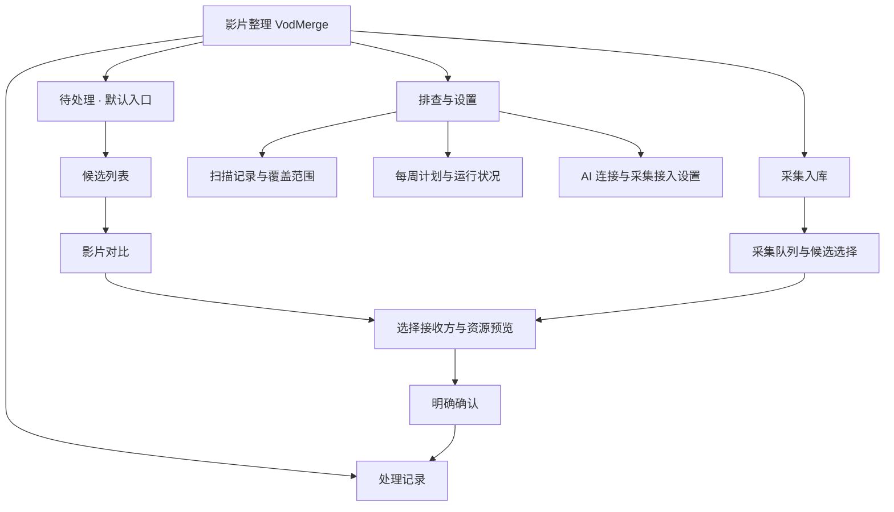
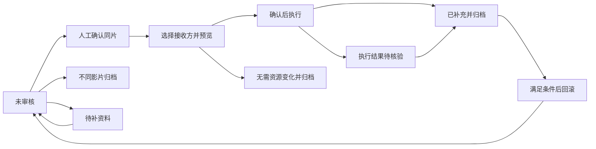

# VodMerge 插件产品与交互设计

> 状态：设计稿，供评审与后续开发；本文中的新页面和新行为尚未实现。  
> 日期：2026-10-16；面向平方视频管理员与插件开发者。  
> 基线：本机 VodMerge 1.7.0 源码、2026-10-13 部署验收记录及本对话的使用反馈。本轮未登录生产后台走查；历史数量不是 10 月 16 日实时统计。本轮仅编写文档。

## 1. 设计结论

把 VodMerge 做成一个能完成影片整理工作的后台工具：**找到值得处理的影片 → 看懂为什么相似 → 决定是否同片 → 预览资源变化 → 确认并留下记录**。

下一版先解决操作闭环，不继续往首页堆叠统计、说明和开关。管理员进入页面，应能直接回答：现在有什么要处理、这一对为什么需要看、点下去会改什么、处理后去哪里找。

三个核心决策：

1. 首页以待审核影片为中心，采集接入、扫描运行状态和 Token 配置各有入口。
2. 明确区分“疑似同片”“人工已确认”“资源已补充”。规则等级和 AI 概率不能代替处理状态。
3. 当前操作统一称为“合并播放资源”。它把资源补充到选中的影片，双方记录与 ID 都保留。让重复条目从前台消失属于另一项功能，需要另行设计隐藏、引用迁移和恢复策略。

本设计的成功标准：管理员无需看操作手册，就能找到一对候选、看懂判断依据、完成预览，并明确知道确认后的变化与回退条件。

## 2. 当前体验为什么差

以下是源码与既有反馈能确认的问题，不作为新一轮线上视觉审计结论。

| 当前问题 | 实际影响 | 设计处理 |
| --- | --- | --- |
| 页面标题为“采集审核”，已有影片排查在同一长页下方 | 从已有库整理进入的人找不到自己的工作入口 | 一级入口改为“影片整理”，默认进入已有影片待审核 |
| 扫描设置、结果统计、候选、AI、人工操作混在一起 | 页面很长，却不清楚下一步做什么 | 工作列表、详情、运行设置分开 |
| “待审核”实际筛掉 `related` 规则等级，没有排除已处理资源任务 | 看过和处理过的结果可能继续出现，数字难以信任 | 用持久化人工结论与操作结果生成待办 |
| 相同影片可能出现在多对结果中，每对都展开大量说明 | 重复阅读，难以连续处理 | 首版收起细节；后续按强身份依据聚合查看 |
| 采集搜索仅搜索当前已加载页，排查主要依赖筛选和翻页 | 找具体影片困难 | 搜索明确覆盖全部对应队列，并支持影片 ID |
| “保留目标”“合并”容易被理解为另一条影片会消失 | 预期与实际写入行为不一致 | 使用“接收资源的影片”，确认页写明两条记录均保留 |
| 规则、冲突、AI 概率同时出现，缺乏主次 | 数字多，却无法判断能否操作 | 先展示关键事实和阻塞原因，AI 作为可选辅助 |
| 已处理记录缺少统一入口 | 不易确认是否成功、谁执行过、能否撤销 | 独立处理记录与详情时间线 |

规模也要求改变交互。10 月 13 日记录有 240,811 对结果，默认规则筛选含 93,252 对；这不等于 93,252 个真实重复影片，也不等于当前尚未处理的工作量。首版不能把这些数字直接包装成“等待合并”。详见[部署验收记录](vodmerge-audit-quality-2026-10-13.md)。

## 3. 插件职责与术语

### 3.1 两条业务路径

| 路径 | 管理员要完成的工作 | 默认行为 |
| --- | --- | --- |
| 整理已有影片 | 找出疑似重复与身份冲突，审核后补充播放资源 | 扫描只记录；既有影片资源操作逐项人工确认 |
| 接收新采集 | 判断新资源应进入哪个已有影片，或是否创建新影片 | 未明确开启的自动化保持关闭；歧义进入人工审核 |

延续现有严格自动首次绑定、已绑定来源自动补集能力，但把它们放到“采集入库”设置中。它们不适用于既有影片排查，也不因此次界面改版自动开启。

### 3.2 页面统一用语

| 用语 | 定义 |
| --- | --- |
| 同一影片 | 身份一致的作品；剧集还需核对季数，资源操作还需核对版本及访问限制 |
| 候选对 | 规则找到的两条可能有关联的记录，尚不是重复结论 |
| 同片依据 | 标题、外部编号、年份、人员等可核对事实；不换算成百分比 |
| AI 同片概率 | Jev 对提供的身份资料作出的模型判断，不是影片库实测准确率 |
| 接收资源的影片 | 本次资源补充的目标记录，其 ID、资料及既有资源保留 |
| 资源来源影片 | 提供播放资源的另一条记录；本次操作后仍存在 |
| 播放条目 | 一条线路下的可选资源；电影中的国语、粤语、字幕版本不能直接称为多集 |
| 线路 | 一组播放条目；相同播放器代码不代表相同资源来源 |

不使用“清理完成”表示扫描完成，不使用“重复已消除”表示资源补充完成。

## 4. 页面结构与默认入口

保留 MacCMS 后台与插件现有安装方式，采用四个工作入口。旧的 `#vm-audit` 链接继续落到已有影片审核，不要求用户重新找菜单。



首页只保留一条排查摘要，例如“上次排查已完成 · 有未完整比较的影片 · 查看详情”。Token 已配置时不占用首页表单；未配置也不阻止规则审核和人工预览。

### 4.1 待处理列表

首版仍以候选对为处理单位，避免为了重做界面先引入复杂影片分组系统。

```text
影片整理                          [待处理] [采集入库] [处理记录] [排查与设置]

已有影片待处理
[搜索片名 / 别名 / 影片 ID                         ] [查找]
[待处理] [待补资料] [稍后处理] [全部]
依据：全部 ▾     只看有冲突 □     发现时间：不限 ▾

影片对                         需要关注的事实                 操作
潜行 / 潜.行 · 2023            豆瓣编号一致；名称写法不同      [审核]
影片甲 / 影片甲 · 不同年份      年份不一致，需先核对资料        [核对资料]

本页 30 对 · 共 N 对符合条件                 [上一页] [下一页]
```

示意中的片名仅说明布局，不代表实时待办。列表不默认展示完整演员表、三项模型概率、任务技术编号和所有规则文本。

默认“待处理”跨扫描轮次展示未完成事项，按规范化影片对去重，包含未审核、已确认同片但未完成资源处理、预览待确认、已回滚需重审和待核验项。新一轮完成不能让旧轮次待办消失。待补资料、尚未到提醒时间的稍后处理项分别查看；已完成及人工判定不同的项目从“处理记录”或“全部”查看。“未审核”只是一种人工结论，不能作为整个默认队列的名称。

- 每行最多显示两条关键依据或一个主要阻塞原因，详细证据在审核页。
- 依据分级作为辅助筛选，不再把“强同片依据”等级当成已审核状态。
- 未审核候选优先展示依据充分且无硬冲突的项目；资料冲突可单独集中处理。相同优先级采用稳定顺序，刷新不随意跳位。
- 搜索在服务端查询对应完整队列。搜索按钮、空结果文案明确作用范围；不把本页查找伪装成全库搜索。
- 未经人工审核且规则认为不同作品或季数的候选默认不进入待处理，在“全部”及对应依据筛选中保留，不自动记为“人工已判定不同”。
- 返回列表保留搜索、筛选、页位置与焦点；完成后可点“审核下一对”，由用户选择继续。

### 4.2 审核详情

采用独立详情视图，顶部有返回入口；桌面左右对比，窄屏按同一字段逐项对照。底部固定操作区不遮挡内容。

```text
← 返回待处理                     潜行 / 潜.行                 状态：未审核

为什么需要审核
豆瓣编号相同 · 上映年份相同 · 名称写法不同

                        影片 A                         影片 B
片名                    潜行                           潜.行
年份                    2023                           2023
导演                    关智耀                         关智耀
季数 / 版本             当前资料                       当前资料
播放资源                1 条线路 · 2 个播放条目          1 条线路 · 1 个播放条目
更多身份资料            [展开]                         [展开]

AI 辅助判断：尚未复核                                  [仅复核这对影片]

[不同影片]  [待补资料]  [稍后处理]                          [确认同片并继续]
```

展示当前资料；扫描时快照放入“历史依据”。资料发生变化时，置顶说明“扫描后资料已变更，请重新核对”，旧规则与旧 AI 结果标记过期。没有真实时长或播放核验时显示“未核验”，不能根据文字资料断言剪辑和音轨完全相同。

“不同影片”保存双向影片对结论；“待补资料”可选择缺少年份、季数、版本等原因，并进入单独队列；“稍后处理”默认延后 7 天，可提前恢复。它们都不修改影片资料或删除候选。

点击“确认同片并继续”时，先按当前身份指纹保存人工同片结论，成功后进入资源接收方选择；保存失败则停留当前页。此后取消或返回只放弃本次资源流程，已保存的同片结论保留，该项显示“同片 · 资源待处理”，仍在默认待处理列表中。更改身份结论需明确操作并留下历史，不随页面关闭撤销。

### 4.3 AI 辅助判断

规则事实始终可读，AI 入口固定在详情中。仅当用户点击时复核所选两条影片，不在列表滚动、刷新、预取下一条时调用。

结果优先呈现“模型倾向：同一影片 / 不同影片 / 无法确定”和“同一影片概率”；展开后显示另外两项概率、模型置信度、复核时间、模型与资料版本。概率和置信度含义不同，置信度概括选项概率分布的集中程度，不能解释为核验通过率。参见 [TypeSafe Choice](https://docs.typesafe.ai/primitives/choice) 与 [Confidence](https://docs.typesafe.ai/confidence)。

AI 不生成不存在的证据解释；关键一致与冲突事实来自字段比较。请求只包含必要身份资料，不包含 Token、播放地址、用户资料或源码。

未配置、认证失败、限流、超时、响应无效、资料过期分别给出明确状态和对应操作。失败不展示 0% 或伪造概率，不阻塞人工判断；相同资料可复用有效结果，主动重试需标明会重新调用。

## 5. 合并播放资源的完整流程

### 5.1 选择资源接收方

进入该步骤后，才出现两张可选影片卡。系统可以提示“这条记录的资料更完整”，并列出事实，但不默认替用户选择目标，不依据资源条目多就认定应保留哪条影片。

页面固定解释：“另一条影片提供资源；本次操作后，两条影片记录仍会保留。”选择改变后，旧预览立即失效。

身份硬冲突、锁定、访问或付费限制不一致时，直接显示具体阻塞原因与“前往视频管理核对”。人工勾选和模型高概率都不能绕过后台校验。资料修改不混入资源合并请求。

### 5.2 资源预览

预览必须回答四件事：接收方是谁、新增什么、跳过什么、有没有不能处理的冲突。

| 预览区域 | 必须显示的内容 |
| --- | --- |
| 本次接收方 | 片名、年份、影片 ID，以及来源影片 |
| 变化总览 | 线路数前后、播放条目数前后；剧集可补充可识别集号范围，无法识别时说明 |
| 逐线路变化 | 原线路不变、新增线路、既有线路补充、重复跳过、冲突阻塞 |
| 逐条目变化 | 条目名称与动作；剧集显示第几集，电影显示语言或版本标签 |
| 结果边界 | 本次不删除来源记录；两条 ID 均保留；资料与可见状态不因资源补充改变 |

默认沿用现有线路规则：未确认同源的线路独立加入；只有播放器代码相同不能直接混到同一线路。遇到同集但地址不一致时阻塞该计划，或由用户明确选择现有“独立线路”方式后重新预览；不静默覆盖已有资源。

**历史真实样本的预期预览**（来自此前验收，执行时必须重新读当前资料）：

| 项目 | 接收方《潜行》#271566 | 来源《潜.行》#705268 | 预期结果 |
| --- | --- | --- | --- |
| 线路 | 1 条：`dyttm3u8` | 1 条：`sxiguam3u8` | 2 条；原线路保留 |
| 播放条目 | HD国语、HD粤语，共 2 个 | HD中字，共 1 个 | 共 3 个播放条目 |
| 影片记录 | 已存在 | 已存在 | 两条记录继续存在 |

正确文案为“新增 1 条线路、1 个播放条目”，不能写成“从 2 集增加到 3 集”。预览不表示资源可播放，也不表示字幕或音轨已实测验证。

预览可保存插件计划，不能写入影片。展示生成时间与失效时间；超过现有 10 分钟有效期、修改目标或线路策略、身份或资源快照变化，都要求重新生成。

### 5.3 确认与完成

最终确认框呈现具体结果，例如：

> 向《潜行》#271566 新增 1 条线路、1 个播放条目。原有 1 条线路及 2 个条目保留；来源《潜.行》#705268 仍存在。  
> [返回预览] [确认合并播放资源]

使用一次有内容的最终确认。身份核对在前一步完成，不增加多次重复空确认。后台仍必须重新检查权限、预览凭证、快照与未完成操作；前端已确认不能替代这些校验。

成功页显示“播放资源已补充”，附任务编号、接收方、实际变化、操作者、时间，以及“查看影片 / 查看处理记录 / 审核下一对”。只有全部相关资源比较完成且实际无需写入时，才允许记录为“已核对，无资源变化”。

确认请求超时不能直接显示失败并鼓励重复提交。先只读查询任务状态：已完成则显示结果，执行中则等待核验，无法确认则进入“待核验”，由“核验执行结果”继续。重复确认不重复追加资源。

### 5.4 回滚

回滚入口位于处理记录详情，不与首次审核的主操作混排。点击后先展示将恢复的线路与条目变化，再明确确认。

回滚恢复本次资源及相关绑定的原值快照，不是删除影片。只有目标仍符合执行后的快照、没有后续资源写入或其他来源依赖等条件时才能自动回滚；否则显示具体冲突和保留的记录，提供核对入口，不能承诺“随时一键撤销”。核验与恢复任务状态也不能绕过这些条件。

回滚后保留完整历史；该影片对重新进入待处理，并显示“已回滚，请重新审核”，不能继续显示“已补充完成”。

## 6. 状态、处理记录与重复提醒

### 6.1 分开保存三个维度

| 维度 | 值与作用 |
| --- | --- |
| 规则依据 | 沿用强同片依据、较多同片依据、资料冲突、资料不足、不同作品或季数等等级，仅支持解释和排序 |
| 人工结论 | 未审核 / 同片 / 不同影片 / 待补资料，记录操作者、原因、时间及当时身份资料指纹 |
| 资源操作 | 未预览 / 预览待确认 / 执行中 / 已补充 / 无资源变化 / 已回滚 / 待核验，关联既有资源任务 |

“稍后处理”只控制提醒时间，不改人工结论。“AI 判断”作为独立证据保存，不自动改写人工结论。

列表状态由这些事实计算：人工同片但未完成资源处理仍属于待处理；预览待确认仍属于待处理；已补充或已核对无变化退出默认待办；不同影片归档到对应筛选；待核验作为需处理异常置顶。



### 6.2 避免每周把旧问题重新推回来

审核结论按规范化影片对 `min(id), max(id)` 保存，不绑定某一轮扫描结果 ID。同一资料的重复发现复用结论，保留各轮发现记录。默认不把用户明确判定不同的同一对反复放回待审核。

资源任务也需要跨轮次关联到该影片对及明确的接收方向。生成计划前检查这对影片既有任务和目标上的未完成操作，不能因新一轮产生了新的结果 ID，就忽略历史已完成或待核验的任务。

- 身份资料变化：原人工结论标记需复核，旧结论留在历史中；AI 结果同步过期。
- 资源变化但身份不变：同片结论可保留；“已补充 / 无变化”的完成性失效，重新比较资源。
- 不同影片结论不因单纯资源更新失效；涉及身份字段变化时才重新提示。
- 候选中的记录消失：标记“记录已不存在”，禁止预览，退出可执行待办并保留历史。
- 规则版本变化：重算规则证据，不静默覆盖人工结论；需重新审核的项目说明原因。

### 6.3 处理记录

覆盖身份结论、资源预览、确认、执行结果、回滚、核验，以及来源自动补集事件。每条记录区分“管理员操作 / 服务器自动任务 / AI 辅助”，有任务关联、时间和实际变化摘要。

现存资源任务按真实状态迁移展示。已 `applied` 的历史任务显示“历史资源已补充”，人工身份结论若没有记录就显示“历史人工结论未记录”，不伪造确认人、确认时间或未发生的审核过程。迁移时核对当前指纹，不能把所有旧候选一键认定已处理。

## 7. 排查能力与运行页面

### 7.1 把覆盖范围讲清楚

运行页面分别显示“执行进度”和“比较覆盖”，而不是只给一个完成百分比。

| 区域 | 展示内容 |
| --- | --- |
| 本轮执行 | 范围、开始与完成时间、已扫描影片数、耗时、当前进度、最近心跳 |
| 结果 | 疑似重复对、身份冲突对；标明计量单位为“对”，不是影片数 |
| 未完整比较 | 候选被截断影片数、缺少资料数量及可用的后续处理入口 |
| 计划 | 每周开关、下一轮时间、时区与比较范围 |
| 异常 | 暂停原因、磁盘余量或 Worker 问题、恢复前需处理事项 |

历史参考：首轮扫描 334,945 条影片，结果 240,811 对，1,794 条影片候选被截断。它说明完成扫描仍可能比较不完整，不能宣称“全库已经排除重复”。这组数字仅作设计容量依据。

### 7.2 后续提升排查质量的顺序

1. **补齐明确漏查范围**：对候选截断项建立可续跑补查，沿用限速与磁盘护栏，不因进入页面自动重跑全库。
2. **覆盖旧影片修改**：新增 ID 排查继续保留；另识别旧 ID 的身份资料变化，更新索引后与旧库比较。不能仅凭原始自增 ID 宣称每周也检查了资料更新。
3. **改善名称召回**：在别名、英文名、标点、季数规范化基础上评估有界模糊召回；先测新增候选数量、人工真值和运行成本。模型不能判断未被召回的影片对。
4. **减少重复审核**：强身份键一致且无矛盾的记录可以聚合展示，但保留每对证据；不能从 A 像 B、B 像 C 推导整组都可合并。首版不提供整组一键合并。

以上属于后续开发方向，不是 1.7.0 已具备能力。周计划仍由服务器成功完成后的调度状态决定；页面读取计划，浏览器关闭也不停止服务器任务。没有新增影片时如实记录 0 条，不能显示“检查了全库”。

## 8. 采集入库与设置体验

采集队列继续展示来源、源记录、候选目标和处理状态。优先查找已绑定的来源身份，再处理首次匹配。详情复用影片对比与资源预览组件；没有可信候选时提供“查找已有影片”和明确的新建流程，不能直接用片名相似创建绑定。

新建确认需展示即将创建的资料、分类和发布状态；它与资源补充的回滚范围不同，不能显示相同的“一键回滚”承诺。首次接入说明放在采集空态和设置中，不占据已有影片审核的主要空间。

“排查与设置”中分别管理：

- **每周排查**：显示当前扫描范围与下一轮时间；重跑全库放在次级操作，先说明范围和当前任务情况。
- **采集自动化**：严格自动首次绑定、已绑定来源补集各自说明触发条件、当前状态与最近执行结果，默认不变更原配置。
- **AI 连接**：未配置 / 已配置未测试 / 最近测试成功 / 最近测试失败；显示时间。Token 始终不回显，服务器环境变量优先时说明修改入口。测试和保存含义分开。
- **运行诊断**：Worker、Cron、版本、最近心跳和异常摘要按需展开，技术编号与部署命令不进入审核主流程。

## 9. 实现边界与最小改造

### 9.1 复用现有能力

保留 PHP / MacCMS 插件结构，复用 `LibraryAudit` 的扫描、规则与按需 AI 复核，以及 `Service` / `Playlist` 的预览、写入、幂等、冲突校验和回滚。页面可在现有控制器下增加视图与查询接口，不为改版引入独立前端服务。

后端是动作可用性的最终来源。页面根据接口提供的可执行动作和阻塞原因展示按钮，提交时再次校验；不在 JavaScript 中复制一套合并规则。

### 9.2 需要补充的最少数据

| 数据 | 用途与边界 |
| --- | --- |
| 影片对审核记录 | 规范化双方 ID、人工结论、原因、身份指纹、提醒时间、操作者及时间；跨扫描轮次复用 |
| 审核事件历史 | 保留结论变化和与既有资源 job 的关联；不能只覆盖一个最终状态 |
| 资源指纹与完成关联 | 以执行完成后的快照判断完成状态是否仍有效；继续引用现有任务计划与快照，不复制播放地址到列表 |

审核记录与事件可以合并为一个最小持久化方案，具体表结构在实施前按查询验证确定。扫描结果继续保留原始发现；已有六张表与历史任务不清空，原规则等级不当作人工结论导入。

### 9.3 接口契约

实施阶段在现有鉴权和 CSRF 下补齐以下能力；这里描述契约，不声明路由已存在：

| 能力 | 必要约束 |
| --- | --- |
| 全队列搜索与筛选 | 服务端分页，明确待办计算口径、选中扫描范围及稳定排序；跨范围的统计分开标注 |
| 审核详情 | 返回当前双方资料、历史证据、人工结论、AI 状态、资源任务及可执行动作；不返回播放地址 |
| 保存人工结论 | 携带当前身份指纹，防止把旧页面判断保存为新资料的结论；不写影片表 |
| 资源预览与确认 | 继续校验目标属于当前影片对、计划凭证、到期时间、双方身份及资源快照 |
| 状态核验与回滚 | 依据任务实际状态及当前依赖，异常恢复不能直接覆盖后续写入 |

沿用当前超级管理员权限边界，不在首版扩展复杂角色系统。Token 只在服务器使用；敏感数据和播放地址不进入 URL、列表、错误消息和外部 AI 请求。

### 9.4 交互与视觉要求

采用现有后台风格，重点改善信息层级。片名和下一步动作最突出；状态用文字与颜色共同表达；编号、模型信息、扫描技术详情降为次要信息。错误提示说明发生了什么、现在能做什么，不仅输出“操作失败”。

列表单行保持紧凑，详情逐步展开，不把大型空白 Token 表单放在首屏。窄屏逐项比较，关键确认不产生横向滚动；全部操作可用键盘完成，弹窗管理焦点，执行反馈可被读屏读取。加载期间显示真实加载状态，读取失败不显示空队列。

## 10. 交付顺序与验收

### 第一批：完成可用的审核闭环

包含四个入口、服务端搜索、独立审核页、人工结论持久化、资源变化预览、完成状态与处理记录。复用现有 AI、资源操作与每周扫描，不扩大自动执行范围。

交付门槛是下表关键场景通过；单纯换色、增加说明或把旧长页拆成几个标签不算完成。

| 场景 | 必须看到的结果 |
| --- | --- |
| 首次进入 | 默认出现已有影片待审核；能直接找到审核操作，不要求先配置 AI |
| 搜索未加载页中的影片 | 返回服务端全队列结果，范围清楚；支持精确 ID |
| 相同身份但名称写法不同 | 关键一致与不同字段可对照；规则无伪造百分比 |
| 电影含语言版本 | 使用播放条目计数；《潜行》历史样本为线路 1→2、条目 2→3，不标成集数 |
| 剧集同集不同资源 | 明确冲突或独立线路方案；不会静默覆盖原条目 |
| 不同季数、版本、访问限制或影片锁定 | 后台阻止不兼容计划，界面指出原因；AI 高分不能解锁 |
| 只打开详情和预览 | 不修改影片、不执行合并、不删除来源；预览可记录插件任务 |
| 切换目标或预览后资料变化 | 旧确认失效，重新预览；过期计划不能提交 |
| 标记不同、待补资料、稍后处理 | 刷新与重新登录后仍有效，分别进入对应列表 |
| 新一轮发现同一对 | 不丢人工结论，不重复推送未变化且已完成的事项 |
| 身份或资源更新 | 按变化类型要求复核或重新比较资源，不覆盖历史结论 |
| AI 不可用 | 状态准确，无假概率，人工审核与预览仍可使用 |
| 确认后响应丢失 | 核验真实状态，重试不重复写入，保留任务关联 |
| 已完成及历史已执行任务 | 从默认待办退出，可在记录中查看真实操作者与变化；缺失历史信息不伪造 |
| 回滚条件满足或被后续写入阻塞 | 前者恢复本次原值并留历史，后者明确阻塞且不覆盖后续更新 |
| 后台任务运行、暂停、读取失败 | 分别显示进度、暂停原因和读取错误，不误报全部完成或没有问题 |
| 旧链接与窄屏 / 键盘 | 旧排查入口可到达正确视图，操作完整可用，返回不丢位置 |

开发验证分三层：确定性规则与状态转换测试；真实数据库隔离表验证写入、幂等与回滚条件；登录后浏览器流程验收。生产真实影片只验证读取和预览，确认、回滚与删除需另有明确操作授权；用隔离测试数据验收写入。

### 第二批：减少漏查与重复工作

按“截断补查 → 旧 ID 资料更新 → 有界模糊召回 → 聚合展示”逐项推进。每项单独比较覆盖、成本和误报，不把几项混合后只报告总条数。

不纳入这两批默认交付：自动删除或隐藏影片、前台重复条目消除、整组合并、全库自动调用模型、根据模型分数自动合并既有影片。

### 如何衡量改善

先采集现有基线，再比较改版结果；以下是拟定验收目标，不是已有实测成绩。

| 指标 | 口径 / 拟定目标 |
| --- | --- |
| 操作可发现性 | 熟悉视频后台的测试者不看说明，在 30 秒内进入一对候选的审核与预览入口 |
| 结果理解 | 确认前能正确说明接收方、资源变化、来源记录是否存在及回滚条件 |
| 连续审核效率 | 同一批有人工真值的样本，记录单对中位处理时间、返回定位次数、放弃原因，与旧页比较 |
| 列表交互性能 | 固定设备、数据规模、网络条件下，列表与搜索响应拟定 P95 ≤ 2 秒；AI 耗时单独记录 |
| 重复工作 | 未变更的已处理影片对不重复进入默认待办；变化后重新出现有明确原因 |
| 匹配质量 | 分层人工标注强依据、冲突、资料不足及未召回样本，分别报告精确率、漏查与无法判定比例 |
| 执行可靠性 | 隔离环境中重复提交不重复追加，失效预览无写入，满足条件的回滚恢复资源原值 |

样本选取、数量和标注分歧须随测试报告记录。只在已召回候选上抽样不能测全库召回率；规则分级数量、AI 概率和单次成功示例也不能代替准确率。

## 11. 评审时需要确定的两项产品边界

1. **是否还需要消除前台重复条目？** 本稿默认先完成身份审核与资源补充。若目标是最终只展示一条，需要另立“主记录与来源记录管理”设计，覆盖链接、收藏、历史、搜索、隐藏与恢复；不沿用当前资源合并按钮暗中执行。
2. **是否值得提供批量 AI 或批量操作？** 本稿沿用逐对按需 AI 与逐次确认；待人工样本、成本和审核效率有实测依据后再决定。

这两项不影响第一批实施，安全默认值已经写明。

## 12. 设计依据与核验边界

- [VodMerge 1.7.0 部署验收](vodmerge-audit-quality-2026-10-13.md)：历史规模、分级口径与能力限制。
- 本机 1.7.0 工作树 `addons/vodmerge/README.md`：安装、采集路径、自动化、资源保留与排查范围。
- `application/admin/view_new/vodmerge/index.html`：当前长页、页内搜索、结果卡片、AI 与人工操作入口。
- `service/LibraryAudit.php::issues()`：当前 `review` 依据筛选与分页；`summary()`：扫描及计划口径。
- `service/Service.php::libraryPreview()`、`libraryApply()`、`rollback()`：资源计划、来源保留、执行与回滚边界。
- 官方 [TypeSafe 文档](https://docs.typesafe.ai/llms.txt)：本次核对 Choice 与置信度定义；本轮未调用 Jev 模型。

源码核对位置为本机管理的 `vodmerge-audit-quality/SquaredMedia` 工作树；设计稿保存在主工作区便于阅读。本文未重新核实 10 月 16 日线上版本、实时数量和登录后页面，后续实施前应核对生产差异。
